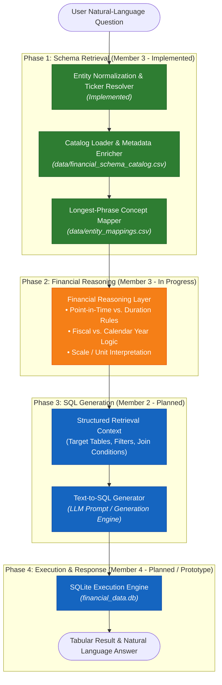

# PolymathAITexttoSql

A Text-to-SQL system designed for financial data, translating natural-language financial questions into accurate SQL queries over structured company financial statements.

---

## 1. Overview

**PolymathAITexttoSql** bridges the gap between natural-language business queries and complex relational financial databases. When users ask questions such as:

> *"What was Apple's gross profit in 2024?"*  
> *"Find operating cash flow and capex for MSFT in 2023."*  
> *"What were Amazon's total assets at the end of fiscal year 2024?"*

the system maps business terminology and ticker symbols to canonical database entities, applies financial period and accounting reasoning, and provides structured schema context to generate and execute accurate SQL queries.

---

## 2. Problem Statement

Querying relational financial databases presents unique challenges for non-technical users and standard Text-to-SQL models:

1. **Terminology Mismatches:** Financial reporting relies on standardized accounting concepts (e.g., `RevenueFromContractWithCustomerExcludingAssessedTax` or `PaymentsToAcquirePropertyPlantAndEquipment`) while users query colloquial terms such as *"sales"*, *"capex"*, *"cogs"*, or *"bottom line"*.
2. **Ambiguous Overlapping Terms:** Words like *"profit"* can refer to *Net Income*, *Gross Profit*, or *Operating Income*. Generic string matching frequently selects the incorrect accounting line item.
3. **Period Semantics:** Balance sheet metrics represent instantaneous points in time (`point_in_time`), whereas income and cash flow statements represent cumulative flows over a reporting period (`period_value`).
4. **Calendar vs. Fiscal Year Discrepancies:** Corporate fiscal years rarely align universally with the January–December calendar year (e.g., Apple's fiscal year ends in late September; Microsoft's ends June 30).
5. **Relational Schema Complexity:** Raw financial facts are normalized across multiple tables (`companies`, `financial_concepts`, `periods`, `filings`, `financial_facts`), requiring multi-table joins that users unfamiliar with SQL cannot construct manually.

---

## 3. Project Objectives

* **Natural-Language Understanding:** Accurately extract company references, financial metrics, and temporal constraints from user questions.
* **Schema-Aware Entity Retrieval:** Map colloquial phrasing and stock tickers to canonical relational tables and database fields using verified catalog metadata.
* **Financial Domain Reasoning:** Incorporate domain rules regarding statement categories, instantaneous vs. duration periods, off-calendar fiscal years, and unit scales.
* **Accurate SQL Generation:** Formulate precise schema prompts and join predicates for SQL generation modules, avoiding hallucinations and ungrounded joins.

---

## 4. Architecture & Workflow

The following flowchart illustrates the end-to-end pipeline, distinguishing verified, implemented components from planned modules:



---

## 5. Technology Stack

Technologies verified and currently active in the repository:

* **Language:** Python 3.10+
* **Data Schemas & Validation:** [Pydantic](https://docs.pydantic.dev/) (v2.13+) for immutable models and strict schema contracts.
* **Data Ingestion & Tables:** [pandas](https://pandas.pydata.org/) (v2.3+) for catalog loading and tabular mappings.
* **Automated Testing:** [pytest](https://docs.pytest.org/) (v9.1+) for unit and validation testing.
* **Database Engine:** [SQLite 3](https://www.sqlite.org/) (relational fact store defined in ETL scripts).
* **Date Utilities:** `python-dateutil` for period date normalization.
* **Data Extraction Scripts:** `requests` and `beautifulsoup4` for SEC/XBRL dataset download pipelines.

---

## 6. Repository Structure

```
PolymathAITexttoSql/
├── data/                                # Production metadata and entity mappings
│   ├── entity_mappings.csv              # 69 verified user-term to canonical database mappings
│   └── financial_schema_catalog.csv     # 18 canonical concepts with accounting & query metadata
│
├── docs/                                # Technical domain documentation
│   └── financial_metadata.md            # Financial concepts, statement rules, and database schema
│
├── retrieval/                           # Member 3: Schema Retrieval & Financial Reasoning
│   ├── __init__.py                      # Package exports
│   ├── catalog.py                       # CatalogLoader with path resolution and column validation
│   ├── mapper.py                        # FinancialEntityMapper with normalization & ticker matching
│   └── models.py                        # Pydantic data models (ConceptMetadata, Matches, Enums)
│
├── tests/                               # Automated test suite
│   └── test_retrieval_mapper.py         # 12 focused pytest tests for retrieval and entity mapping
│
├── requirements-retrieval.txt           # Pinned dependencies for the retrieval module
├── financial_query_pipeline.py          # Interactive prototype demonstrating end-to-end lookup
├── query_financial_data.py              # CLI prototype executing sample parameterized queries
│
├── clean_financial_data.py              # Member 1: SEC XBRL fact cleaning and deduplication
├── create_financial_database.py         # Member 1: SQLite schema creation and data loading
├── create_schema_catalog.py             # Member 1: Schema catalog CSV exporter
├── create_entity_mappings.py            # Member 1: Entity mappings CSV exporter
├── create_financial_metadata.py         # Member 1: Metadata documentation generator
│
└── download_*.py / inspect_*.py         # Member 1: SEC XBRL and macroeconomic ingest scripts
```

---

## 7. Schema Retrieval and Financial Reasoning Module

The core logic implemented in [`retrieval/`](retrieval/) provides robust, isolated schema retrieval:

### 1. Robust Path Resolution & Schema Validation (`retrieval/catalog.py`)
* Resolves file locations relative to the module's filesystem root, allowing execution from any working directory.
* Validates that all required columns are present in [`data/financial_schema_catalog.csv`](data/financial_schema_catalog.csv) and [`data/entity_mappings.csv`](data/entity_mappings.csv).
* Fails fast with clear `FileNotFoundError` or `ValueError` exceptions upon detecting missing files or schema drifts.

### 2. Normalization & Preprocessing (`retrieval/mapper.py`)
* Normalizes casing, strips surrounding quotes, brackets, and question marks, and collapses whitespace.
* Handles punctuation variations (e.g., `"apple inc."` vs. `"apple inc"`).
* Preserves domain-critical symbols such as `&` in `"PP&E"` and `.` in `"amazon.com"`.

### 3. Ticker and Company Resolution
* Resolves stock ticker symbols (`AAPL`, `MSFT`, `AMZN`) and corporate abbreviations (`microsoft corp`, `apple computer`) to exact database primary strings (`"Apple Inc."`, `"Microsoft Corporation"`, `"Amazon.com Inc."`).

### 4. Longest-Phrase Matching
* Specific multi-word financial phrases take strict precedence over shorter substrings.
* Prevents collision errors: `"gross profit"` resolves to `Gross Profit` and `"operating profit"` resolves to `Operating Income`, rather than collapsing into generic `"profit"` (`Net Income`).
* In free-form query extraction, non-overlapping greedy spans ensure terms like `"operating cash flow"` are consumed before generic `"cash"` can match.

### 5. Catalog Metadata Attachment
* Matched financial concepts are automatically enriched with complete accounting metadata from [`data/financial_schema_catalog.csv`](data/financial_schema_catalog.csv):
  * `concept_id`, `statement_type` (`Balance Sheet`, `Income Statement`, `Cash Flow Statement`)
  * `period_type` (`instant`, `duration`)
  * `query_type` (`point_in_time`, `period_value`)
  * `expected_unit` (`USD`)
  * `xbrl_tag` (e.g., `RevenueFromContractWithCustomerExcludingAssessedTax`)

### 6. Strict Unknown Handling
* Unknown metrics (e.g., `"ebitda"`, `"cryptocurrency"`) and unsupported companies (e.g., `"tesla"`) return `None` or `is_matched=False`. The module refuses to hallucinate or silently guess mappings.

---

## 8. Dataset Scope and Assumptions

All assumptions are grounded directly in the verified repository data and ETL code:

* **Company Scope:** 3 companies: Amazon.com Inc., Apple Inc., and Microsoft Corporation.
* **Concept Scope:** 18 canonical US-GAAP financial line items covering the Balance Sheet (9), Income Statement (5), and Cash Flow Statement (4).
* **Filing Source:** SEC Company Facts XBRL dataset, restricted to annual 10-K filings (`FY`).
* **Earliest-Filing / Restatement Behavior:** As implemented in [`clean_financial_data.py`](clean_financial_data.py), the cleaning process prioritizes the filing where the reported fiscal year matches the period-end year, sorted by `filing_date` ascending with `keep="first"`. The project currently preserves **earliest reported figures** and discards later restatements or amendments.
* **Fiscal Year vs. Calendar Year:** Companies in this dataset operate on distinct fiscal calendars (e.g., Apple's fiscal year ends late September; Microsoft's ends June 30). In the current data layer, `fiscal_year` was normalized from the period-end year. Universal calendar years are **not** assumed, and final fiscal-year query conventions remain subject to team alignment.
* **Units and Currency:** All monetary values are recorded unscaled in USD.

---

## 9. Setup Instructions (Windows PowerShell)

Follow these steps to set up the development environment and verify the installation:

```powershell
# 1. Clone the repository and enter the directory
git clone https://github.com/soham1251130190-pixel/PolymathAITexttoSql.git
cd PolymathAITexttoSql

# 2. Create and activate a Python virtual environment
python -m venv .venv
.\.venv\Scripts\Activate.ps1

# 3. Install required retrieval dependencies
pip install -r requirements-retrieval.txt

# 4. Run the automated test suite
pytest tests/test_retrieval_mapper.py -v
```

---

## 10. Testing

The module includes an automated suite in [`tests/test_retrieval_mapper.py`](tests/test_retrieval_mapper.py) covering catalog loading, schema validation, exact matching, normalization, ticker resolution, longest-phrase disambiguation, metadata enrichment, and rejection of unknown terms.

### Running Focused Tests:
```powershell
pytest tests/test_retrieval_mapper.py -v
```

### Verified Test Run:
```
============================= test session starts =============================
platform win32 -- Python 3.10.11, pytest-9.1.1, pluggy-1.6.0
collected 12 items

tests/test_retrieval_mapper.py::test_catalog_loader_default_paths PASSED [  8%]
tests/test_retrieval_mapper.py::test_catalog_loader_missing_file PASSED  [ 16%]
tests/test_retrieval_mapper.py::test_catalog_loader_missing_columns PASSED [ 25%]
tests/test_retrieval_mapper.py::test_mappings_loader_missing_columns PASSED [ 33%]
tests/test_retrieval_mapper.py::test_exact_matches_from_csv PASSED       [ 41%]
tests/test_retrieval_mapper.py::test_normalization_variations PASSED     [ 50%]
tests/test_retrieval_mapper.py::test_ticker_aliases PASSED               [ 58%]
tests/test_retrieval_mapper.py::test_longest_phrase_matching_isolated PASSED [ 66%]
tests/test_retrieval_mapper.py::test_longest_phrase_matching_in_queries PASSED [ 75%]
tests/test_retrieval_mapper.py::test_catalog_metadata_attachment PASSED  [ 83%]
tests/test_retrieval_mapper.py::test_unknown_terms PASSED                [ 91%]
tests/test_retrieval_mapper.py::test_untyped_resolution PASSED           [100%]

============================= 12 passed in 2.49s ==============================
```

---

## 11. Current Status & Future Work

| Component | Module / Owner | Status | Details |
| :--- | :--- | :--- | :--- |
| **Catalog & Entity Datasets** | Member 1 | **Implemented** | 18 concepts, 69 entity mappings in [`data/`](data/). |
| **Data Ingestion & Cleaning ETL** | Member 1 | **Implemented** | SEC XBRL extraction scripts; earliest-filing deduplication. |
| **Catalog Loader & Entity Mapper** | Member 3 | **Implemented** | Normalized matching, ticker resolution, longest-phrase matching, metadata enrichment (`retrieval/`). |
| **Financial Reasoning Layer** | Member 3 | **In Progress** | Handling fiscal vs. calendar year queries, unit scale factors (millions/billions), and derived metrics (e.g., Free Cash Flow). |
| **Schema Retrieval Context Builder**| Member 3 | **In Progress** | Packaging tables, columns, and foreign key join recipes for Member 2's SQL generator. |
| **Text-to-SQL Generator** | Member 2 | **Planned** | LLM prompt engineering / SQL generation from retrieval context. |
| **Execution & Post-Processing** | Member 4 | **Planned / Prototype**| SQL validation, execution against SQLite database, and answer formatting. |

---

## 12. Contributing & Team Workflow

1. **Branching Strategy:** Work on designated team or feature branches (e.g., `schema-retrieval` or `feature/<feature-name>`). Do not commit directly to `main`.
2. **Path Standards:** Keep all file references relative to project roots or configurable via parameters. Do not assume hardcoded local directories.
3. **Data Integrity:** Do not overwrite Member 1's baseline CSV files in [`data/`](data/) without cross-team review.
4. **Testing Obligation:** All new retrieval features must be accompanied by focused unit tests in [`tests/`](tests/). Ensure `pytest tests/ -v` passes cleanly before submitting pull requests.

---

## 13. License

*Pending confirmation.* (No license file is currently present in the repository; refer to repository maintainers for distribution terms.)
